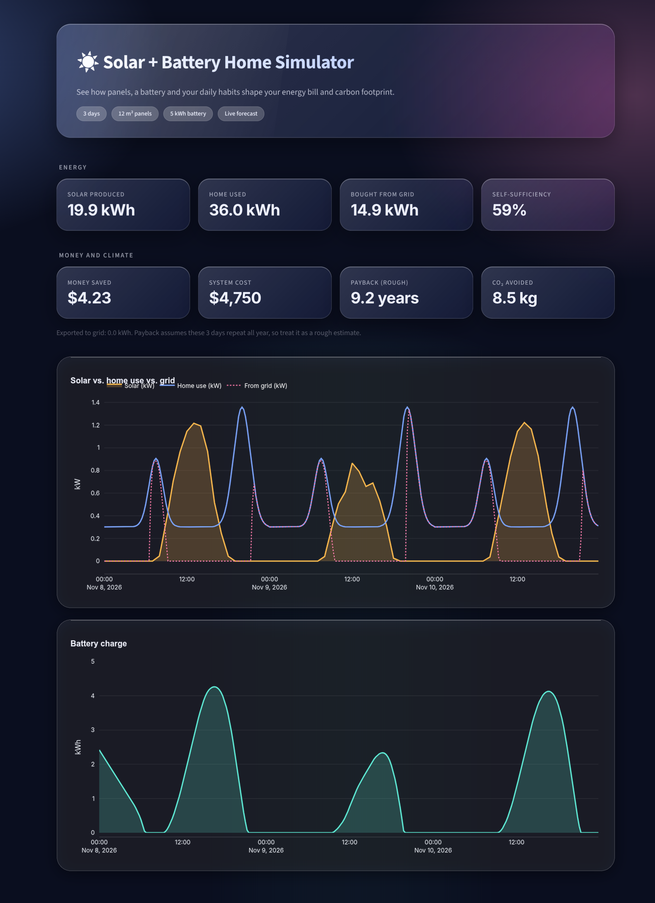

# ☀️ Solar + Battery Home Simulator

An interactive web app that shows how solar panels, a home battery and everyday electricity use work together, and what that means for your energy bill and carbon footprint.

**🔗 Live demo:** https://solar-sim-habib.streamlit.app


## What it does

Move the sliders and the model re-runs instantly. You can:

- Size the **solar array** (area and efficiency).
- Choose **simulated sunlight** or load a **real multi-day forecast** for a city (Algiers, St. Petersburg, Paris, Dubai, or custom coordinates).
- Set household consumption and a **battery** (capacity, maximum power, round-trip efficiency).
- See the results: solar produced, energy bought from the grid, self-sufficiency, money saved, rough payback time and CO₂ avoided.
- Simulate **1 to 7 days**, with the battery carrying its charge from one day to the next.

## How the model works

The simulation steps through time in 15-minute intervals.

**Solar power**

```
P_solar (kW) = irradiance (W/m²) × panel area (m²) × panel efficiency / 1000
```

**Household load.** A synthetic daily curve with a small base load plus a morning and an evening peak, scaled so it adds up to the daily consumption you choose.

**Battery logic.** At every step:

1. If solar exceeds the load, the surplus charges the battery (limited by max power and remaining capacity). Anything left over is exported to the grid.
2. If the load exceeds solar, the battery discharges to cover the gap (limited by max power and stored energy). Anything still missing is bought from the grid.

Battery losses are modelled by applying `√(round-trip efficiency)` once when charging and once when discharging.

**Economics and climate**

```
savings        = cost without solar − (grid purchases − export income)
payback (yrs)  = system cost / (savings per day × 365)
CO₂ avoided    = (energy consumed − energy bought from grid) × grid CO₂ factor
```

## Data sources

- **Real weather:** [Open-Meteo](https://open-meteo.com/) hourly shortwave solar radiation forecast (free, no API key).
- **Simulated mode:** a sine-shaped sun curve between 06:00 and 18:00, reduced by a cloud-cover factor.

## Tech stack

Python · [Streamlit](https://streamlit.io/) · NumPy · pandas · Plotly · Requests

## Run it locally

```bash
git clone https://github.com/dmh404glitch/solar-sim.git
cd solar-sim
python3 -m venv venv
source venv/bin/activate
pip install -r requirements.txt
streamlit run app.py
```

## Limitations

This is a learning project and a deliberately simplified model:

- The household load curve is synthetic, not measured data.
- Panel tilt, orientation, shading, temperature effects and inverter losses are ignored. Panel output is computed from horizontal radiation.
- The battery starts at 50% charge, and it has no ageing or depth-of-discharge limits.
- Payback assumes the simulated days repeat all year, so it is a rough estimate only.
- Prices, costs and the grid CO₂ factor are editable placeholders, not market data.

## Ideas for next steps

- Use real hourly household consumption data.
- Model panel tilt and orientation, and temperature-dependent efficiency.
- Add time-of-use electricity tariffs and a smarter battery strategy.
- Compare several system sizes automatically and find the best payback.
- Add battery degradation over the years.

## About

Built by **Drif Mohamed Habib** as a hands-on way to combine power engineering knowledge with programming. <!-- Edit this line: add your background, your GitHub or LinkedIn link, and what you're learning next. -->
